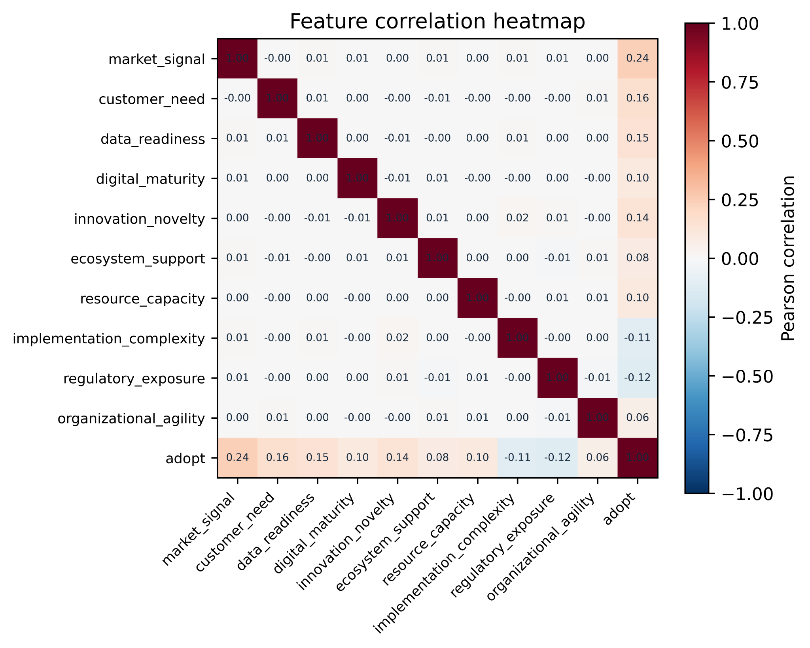
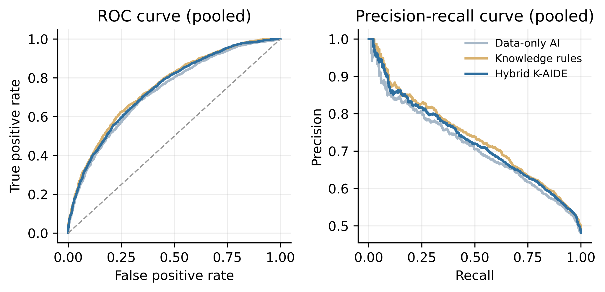

# Data-Driven Knowledge-Based AI for Digital Transformation, Innovation, and Entrepreneurship: An Explainable Opportunity-Assessment Framework

**Nithish Kumar Maley**  
**Short Communication**  
**Affiliation:** Doctorate of Business Administration (DBA) Program, Midwest University, 851 Parr Rd, Wentzville, MO 63385, USA  
**Corresponding author:** nithish.maley4603@gmail.com

## Abstract

Digital transformation decisions combine measurable signals with domain constraints that are rarely represented in a single data table. This Short Communication presents K-AIDE, a data-driven knowledge-based artificial intelligence framework for assessing digital innovation opportunities in entrepreneurial settings. K-AIDE combines a supervised data model with an explicit knowledge layer containing weighted criteria, hard constraints, and interaction rules. The knowledge layer produces an interpretable opportunity score and rule trace, while the data model captures nonlinear patterns in business and market indicators. A controlled benchmark of 15,000 deterministic synthetic records, evaluated across five fixed random seeds, demonstrates the method. The hybrid model achieved mean ROC-AUC 0.7450 (SD 0.0128), mean Brier score 0.2098 (SD 0.0031), and mean accuracy 0.6722 (SD 0.0224). The knowledge rules achieved the strongest ranking performance, with ROC-AUC 0.7539, while the hybrid model provided the best calibration and accuracy. A component ablation and paired error analysis show how each layer contributes to the result. These are reproducibility results rather than evidence of performance in a particular industry. The contribution is a compact, auditable design that connects knowledge engineering, data science, explainable AI, and business decision support.

**Keywords:** artificial intelligence; data science; knowledge-based systems; decision support; digital transformation; innovation; entrepreneurship

## Highlights

- Combines business data with explicit domain knowledge.
- Adds interpretable rules to a supervised AI model.
- Produces opportunity scores and rule-based explanations.
- Demonstrates repeated-seed reproducible evaluation.
- Separates data and knowledge contributions by ablation.

## 1. Introduction

Digital transformation changes how organizations create value, organize work, and engage with customers [1,2]. For entrepreneurs and innovation managers, the decision is rarely whether a digital technology exists. The practical decision is which opportunity should be pursued, with which resources, and under which constraints. Market demand, customer need, data readiness, organizational capability, regulatory exposure, and implementation complexity all influence that decision. These signals are heterogeneous and often incomplete [5,6]. A system that uses only historical data can identify associations, but it may overlook a policy constraint or a condition that business experts regard as non-negotiable.

Digital entrepreneurship is shaped by the interaction between digital technologies and entrepreneurial processes [3]. This interaction creates a knowledge problem as well as a prediction problem. A decision-support system must use available observations while also representing relationships, thresholds, and constraints that are meaningful to the organization. Knowledge-based systems are well suited to this combination because they can encode domain concepts and reasoning procedures alongside computational models [9,10]. The KBS aims and scope include data science, knowledge representation and engineering, intelligent decision-support systems, prediction systems, and business applications. The framework proposed here addresses these topics through a focused opportunity-assessment task.

Artificial intelligence can support managers by augmenting analysis and expanding the range of alternatives considered [4,5,6]. However, AI-supported recommendations are difficult to use when a manager cannot understand why an opportunity was ranked highly or why a recommendation was blocked. Explainability is therefore treated as a design requirement rather than an after-the-fact visualization [8-11]. The aim of this Short Communication is to present a compact hybrid method that joins a data model with an explicit knowledge layer and produces both a decision score and an explanation.

The contribution is threefold. First, the paper specifies K-AIDE, a knowledge-augmented intelligent decision engine for digital transformation, innovation, and entrepreneurship. Second, it gives an auditable scoring formulation and a short implementation procedure. Third, it provides a repeated-seed benchmark, component ablation, and compact code package. The methodological gap addressed is the lack of a compact evaluation that separates learned patterns from explicit business rules within one opportunity-assessment workflow. The benchmark is deliberately synthetic and controlled. It demonstrates method behavior and reproducibility; it does not make claims about a population of firms.

## 2. K-AIDE framework

### 2.1. Design requirements

K-AIDE was designed around four requirements. The first is **data integration**: the model should accept indicators describing an opportunity and its organizational setting. The second is **knowledge integration**: domain experts should be able to specify criteria, thresholds, and relationships without retraining the data model. The third is **decision transparency**: every recommendation should expose the main score components and the rules that affected the result. The fourth is **operational simplicity**: the method should be implementable with a small software footprint and support a transition from an illustrative benchmark to approved organizational data.

The framework is not intended to replace entrepreneurial judgment. It provides a repeatable screening layer that helps a decision-maker compare opportunities, identify missing capabilities, and see where a recommendation depends on a constraint. This human-in-the-loop orientation is consistent with research on augmentation, explainable decision support, and responsible AI [4,10,11].

### 2.2. Data and knowledge layers

The data layer contains ten normalized indicators: market signal, customer need, data readiness, digital maturity, innovation novelty, ecosystem support, resource capacity, implementation complexity, regulatory exposure, and organizational agility. The indicators are examples rather than a universal measurement instrument. In an applied study, each should be operationalized with validated measures and documented data provenance.

The knowledge layer contains three kinds of objects. **Weighted criteria** represent the relative importance of value, feasibility, innovation, and organizational readiness. **Hard constraints** represent conditions under which an opportunity should be blocked or strongly penalized. **Interaction rules** represent useful combinations, such as the joint presence of market demand and innovation novelty. In the executable benchmark, the low-readiness gate is activated when data readiness is below 0.22 and digital maturity is below 0.25; the regulatory gate is activated when regulatory exposure exceeds 0.82 while data readiness is below 0.45; and the market-novelty synergy is activated when market signal exceeds 0.62 and innovation novelty exceeds 0.68. The knowledge layer can be implemented as a rules table, lightweight ontology, or knowledge graph. Such representations support explicit semantics and limited-interaction reasoning in decision workflows [9]. The important property is that the reasoning structure remains inspectable and can be revised independently from the statistical model.

### 2.3. Hybrid inference and explanation

Let p_data(x) be the probability returned by the data model for opportunity x, and let s_KB(x) be the normalized score returned by the knowledge layer. The hybrid decision score is:

**(1)**  *p_K-AIDE(x) = α p_data(x) + (1 - α) s_KB(x)*

where 0 ≤ α ≤ 1. The demonstration uses α = 0.65; a separate alpha-sensitivity sweep is included in the reproducibility outputs. In an applied study, α should be selected on validation data. The knowledge score uses the weighted criteria and thresholds in Section 2.2, adds 0.10 for the market-novelty synergy, subtracts 0.32 when either hard gate is active, and maps the resulting score z_KB to the closed interval 0 to 1 with clip((z_KB + 0.20)/1.10, 0, 1). A rule trace records the conditions that contributed to the score. The final output contains (i) a ranked opportunity score, (ii) the data-model probability, (iii) the knowledge score, and (iv) the activated rules.

Figure 1 provides a data-audit view of the controlled benchmark. The ten input indicators are almost uncorrelated with one another, while the simulated adoption outcome is most positively associated with market signal (r = 0.24), customer need (r = 0.16), and data readiness (r = 0.15), and negatively associated with regulatory exposure (r = -0.12) and implementation complexity (r = -0.11). This pattern is consistent with an opportunity-screening setting in which the knowledge layer adds explicit thresholds and interactions rather than merely duplicating redundant inputs. The heatmap should be read as a diagnostic of the synthetic benchmark, not as an empirical claim about business data.

*Fig. 1. Feature correlation heatmap for the ten normalized indicators and simulated adoption outcome. Values are Pearson correlations computed on the pooled 15,000-record synthetic benchmark; the heatmap is a reproducibility diagnostic, not evidence from an observed industry dataset.*

### 2.4. Assessment procedure

The executable assessment follows five steps. First, it normalizes the opportunity indicators and separates training and test records. Second, it calculates the knowledge score and records every activated rule. Third, it fits a random-forest classifier to the training indicators. Fourth, it blends the data probability and knowledge score using Eq. (1). Fifth, it returns the score, the rule trace, and a ranking that a manager can review. The procedure keeps the symbolic layer visible rather than embedding all reasoning inside the statistical model.

## 3. Demonstration design

### 3.1. Controlled benchmark

The demonstration uses 15,000 opportunity records generated across five fixed random seeds, with 3,000 records per seed. Each record contains the ten indicators listed in Section 2.2, sampled from bounded distributions to represent normalized business signals. A latent adoption value is generated from value, feasibility, risk, and interaction terms. Two explicit knowledge constraints are then applied: the low-readiness gate and the regulatory gate defined in Section 2.2. A synergy rule rewards opportunities with both a strong market signal and high innovation novelty. The binary outcome indicates whether an opportunity passes the simulated adoption threshold.

This design makes it possible to test whether a model that exposes the knowledge structure behaves differently from a model that receives only raw indicators. The benchmark does not represent a real industry, and the rules are not claimed to be universal. Its purpose is reproducibility: another researcher can run the supplied script with the same five seeds and regenerate the data, figures, and metrics.

### 3.2. Baselines, repeated evaluation, and ablation

Three estimators are compared. The **data-only AI** is a random forest trained on the ten indicators. Random forests are a useful baseline for a short proof of concept because they model nonlinear interactions without requiring a large neural architecture [12]. The implementation uses 350 trees, a minimum leaf size of 8, class-balanced weights, single-threaded execution, and the benchmark seed as the model seed. The **knowledge rules** estimator uses the normalized knowledge score without training. The **hybrid K-AIDE** estimator combines the data-model probability and the knowledge score using Eq. (1). Each seed uses a stratified 70% training and 30% test split, yielding 900 held-out records per seed and 4,500 paired held-out records overall. A capability perspective is also relevant because model performance depends on complementary organizational resources, not only on the algorithm [7].

The evaluation reports ROC-AUC, PR-AUC, Brier score, and accuracy. ROC-AUC and PR-AUC evaluate ranking and positive-class retrieval, while the Brier score evaluates probabilistic calibration. These predictive measures are appropriate for a screening system because they separate ranking quality from probability quality [13]. Accuracy is a secondary descriptive measure. Table 1 reports the mean and standard deviation across seeds.

The component ablation in Table 2 evaluates the 2 x 2 presence or absence of the data and knowledge layers: neither layer, data only, knowledge rules only, and the hybrid. Paired two-sided Wilcoxon tests compare record-level squared errors for the hybrid against each single-layer alternative. Because the benchmark is synthetic, these tests describe reproducibility within the generated scenarios and do not support population-level inference.

## 4. Results and discussion

Table 1 shows that the knowledge rules achieved the highest ranking performance, with mean ROC-AUC 0.7539 and PR-AUC 0.7373. The hybrid model produced the lowest Brier score, 0.2098, and the highest accuracy, 0.6722. Compared with the data-only model, the hybrid improved ROC-AUC from 0.7311 to 0.7450, reduced the Brier score from 0.2104 to 0.2098, and increased accuracy from 0.6709 to 0.6722. The standard deviations are small relative to the mean differences, although they should not be interpreted as confidence intervals for real organizations.

**Table 1. Repeated-seed baseline comparison**

| Estimator | ROC-AUC | PR-AUC | Brier score | Accuracy |
|---|---:|---:|---:|---:|
| Data-only AI | 0.7311 (0.0166) | 0.7119 (0.0164) | 0.2104 (0.0046) | 0.6709 (0.0241) |
| Knowledge rules | 0.7539 (0.0090) | 0.7373 (0.0155) | 0.2184 (0.0027) | 0.6307 (0.0086) |
| Hybrid K-AIDE | 0.7450 (0.0128) | 0.7266 (0.0138) | 0.2098 (0.0031) | 0.6722 (0.0224) |

Values are mean (standard deviation) across five fixed seeds. Higher is better for ROC-AUC, PR-AUC, and accuracy; lower is better for Brier score.

Figure 2 shows pooled receiver-operating-characteristic (ROC) and precision-recall (PR) curves across 4,500 held-out records. The knowledge-rules curve is generally highest, followed closely by hybrid K-AIDE, and both are above data-only AI over much of the operating range. This visual ordering agrees with the mean ROC-AUC and PR-AUC values in Table 1. The blend-sensitivity sweep remains available in the repository as a reproducibility output; α should be selected on validation data rather than treated as universal.

*Fig. 2. Pooled ROC and precision-recall curves for data-only AI, knowledge rules, and hybrid K-AIDE across 4,500 held-out records from five fixed seeds.*

Table 2 separates the contributions of the two components. Removing both layers produces a near-chance reference. The data-only and knowledge-only variants recover useful structure, but the hybrid has the lowest Brier score and highest accuracy. The two-sided paired tests on the 4,500 record-level squared-error pairs give *p* = 3.147e-05 for the hybrid versus data-only comparison and *p* = 1.995e-20 for the hybrid versus knowledge-rules comparison. These p-values are descriptive within the generated benchmark and should not be presented as field-study significance.

**Table 2. 2 x 2 component ablation**

| Variant | Data model | Knowledge layer | ROC-AUC | PR-AUC | Brier score | Accuracy |
|---|:---:|:---:|---:|---:|---:|---:|
| Neither layer | No | No | 0.5000 | 0.4804 | 0.2500 | 0.4804 |
| Data-only AI | Yes | No | 0.7311 | 0.7119 | 0.2104 | 0.6709 |
| Knowledge rules | No | Yes | 0.7539 | 0.7373 | 0.2184 | 0.6307 |
| Hybrid K-AIDE | Yes | Yes | 0.7450 | 0.7266 | 0.2098 | 0.6722 |

Values are means across five fixed seeds. Paired two-sided Wilcoxon tests on record-level squared errors from the same held-out records give p = 3.147e-05 for hybrid versus data-only and p = 1.995e-20 for hybrid versus knowledge rules. These p-values are descriptive within the generated benchmark and do not support population-level inference.

The alpha-sensitivity sweep and optional diagnostic outputs are retained in the repository for auditability; they are not part of the two-figure main submission.

## 5. Implications

The main implication is methodological. Digital transformation and entrepreneurial innovation decisions are not purely predictive tasks. They combine measurable signals with organizational knowledge about resources, risk, compliance, and feasibility [1,5,9,10]. A data-only model may learn useful associations, but it cannot guarantee that a decision respects an explicit constraint unless that constraint is represented in the system. K-AIDE makes the two sources visible and allows them to be evaluated separately.

The framework also has a practical implication for innovation governance. A manager can inspect whether an opportunity received a high score because of market and customer signals, because the organization is ready to implement it, or because an interaction rule was activated. This explanation supports a more productive discussion between technical teams, entrepreneurs, and decision-makers. It also creates a record of why a decision-support system recommended or blocked an opportunity. The design follows the principle that interpretable models should be preferred when decision consequences are material [8,10,11].

For researchers, the framework creates several testable extensions. A future study could replace the synthetic benchmark with longitudinal venture or innovation-portfolio data, compare different knowledge representations, and estimate how knowledge revisions affect model drift. Another study could compare rule-based explanations with model-agnostic explanations such as local feature attribution [8,10]. A further extension could use a knowledge graph to represent relationships among technologies, capabilities, markets, and regulatory requirements, then evaluate graph-based retrieval against a flat rules table and recent graph-based data-fusion methods [9,27-29].

The framework is compatible with digital-transformation research. Digital transformation changes organizational capabilities and business models [1,2], while entrepreneurship research emphasizes how digital technologies change opportunity creation and discovery [3]. Business-model design is tied to dynamic capabilities and the ability to reconfigure resources [14], while innovation portfolios must balance exploration of new possibilities with exploitation of existing knowledge [15]. Recent IEEE engineering-management studies likewise connect digital transformation with SME persistence, SME adoption drivers, supply-chain implementation, employee digital literacy, collaborative innovation, exploratory/exploitative innovation, AI-enabled business-model innovation, strategy selection, and new service opportunities [16-22,25,26]. MDPI studies further connect digital capability and entrepreneurial orientation with digital sustainable entrepreneurship and SME value creation [23,24]. K-AIDE translates these ideas into a computational task: ranking opportunities under data and knowledge constraints. This translation connects management research to the technical expectations of a knowledge-based AI journal.

## 6. Limitations and next steps

The most important limitation is the synthetic benchmark. Because the data-generating process includes the same types of rules used by the knowledge layer, the experiment demonstrates controlled behavior rather than external validity. The reported metrics should not be interpreted as evidence that K-AIDE will outperform a data-only model in a particular industry. A follow-up study should preregister the operational definitions, collect or obtain an approved real dataset, and evaluate the method with a held-out temporal or organizational test set.

The second limitation is that the current knowledge layer is small and manually specified. A production system would require a governance process for approving rules, tracking versions, resolving conflicts, and monitoring whether a rule remains valid as markets and regulations change. The third limitation is that the benchmark contains normalized numeric variables and does not address missing data, concept drift, class imbalance under real conditions, or the social consequences of entrepreneurial recommendations. These limitations define the next empirical steps rather than hidden assumptions of the current demonstration.

## 7. Conclusion

This Short Communication presented K-AIDE, a compact data-driven knowledge-based AI framework for digital transformation, innovation, and entrepreneurship decisions. The method combines a supervised data model with explicit criteria, constraints, and interaction rules and returns both a score and an explanation. Across five reproducible seeds, the knowledge layer improved ranking while hybrid inference produced the best calibration and accuracy. The ablation makes the source of the improvement visible and the code package permits exact regeneration of the figures and tables. The work provides a technically implementable starting point for a larger empirical study using approved organizational or venture data.

## Data availability statement

The benchmark data are synthetic and deterministic. The accompanying code and combined 15,000-record CSV (seeds 42–46) are included for auditability. The reproducibility package is available at https://github.com/Nithish4603/DBA802.

## Declaration of competing interest

The author declares that there are no known competing financial interests or personal relationships that could have influenced the work reported in this manuscript.

## Declaration of generative AI and AI-assisted technologies in the manuscript preparation process

During preparation of this manuscript and the accompanying demonstration code, generative-AI and AI-assisted tools were used to support manuscript organization, language improvement, technical documentation, and software-development assistance. Publicly available online resources were also consulted for background information, methodological guidance, and implementation support; relevant sources are cited in the manuscript. The author reviewed and edited all AI-assisted material and independently verified the references, dataset construction, code, figures, experimental results, interpretations, and conclusions. The author takes full responsibility for the final content and confirms that no AI system is listed as an author. AI tools were not used to fabricate data, results, or citations. The figures are generated deterministically from the supplied Python code.

## Funding

This research received no specific grant from any funding agency in the public, commercial, or not-for-profit sectors.

## CRediT authorship contribution statement

Nithish Kumar Maley: Conceptualization, Methodology, Software, Validation, Data curation, Formal analysis, Visualization, Writing - original draft, Writing - review and editing.

## References

[1] P.C. Verhoef, T. Broekhuizen, Y. Bart, A. Bhattacharya, J.Q. Dong, N. Fabian, M. Haenlein, Digital transformation: A multidisciplinary reflection and research agenda, J. Bus. Res. 122 (2021) 889-901. https://doi.org/10.1016/j.jbusres.2019.09.022.

[2] G. Vial, Understanding digital transformation: A review and a research agenda, J. Strateg. Inf. Syst. 28 (2019) 118-144. https://doi.org/10.1016/j.jsis.2019.01.003.

[3] S. Nambisan, Digital entrepreneurship: Toward a digital technology perspective of entrepreneurship, Entrep. Theory Pract. 41 (2017) 1029-1055. https://doi.org/10.1111/etap.12254.

[4] S. Raisch, S. Krakowski, Artificial intelligence and management: The automation-augmentation paradox, Acad. Manag. Rev. 46 (2021) 192-210. https://doi.org/10.5465/amr.2018.0072.

[5] Y. Duan, J.S. Edwards, Y.K. Dwivedi, Artificial intelligence for decision making in the era of Big Data-evolution, challenges and research agenda, Int. J. Inf. Manag. 48 (2019) 63-71. https://doi.org/10.1016/j.ijinfomgt.2019.01.021.

[6] S.M.C. Loureiro, J. Guerreiro, I. Tussyadiah, Artificial intelligence in business: State of the art and future research agenda, J. Bus. Res. 129 (2021) 911-926. https://doi.org/10.1016/j.jbusres.2020.11.001.

[7] P. Mikalef, M. Gupta, Artificial intelligence capability: Conceptualization, measurement calibration, and empirical study on its impact on organizational creativity and firm performance, Inf. Manag. 58 (2021) 103434. https://doi.org/10.1016/j.im.2021.103434.

[8] A.B. Arrieta, N. Díaz-Rodríguez, J. Del Ser, A. Bennetot, S. Tabik, A. Barbado, S. Garcia, S. Gil-Lopez, D. Molina, R. Benjamins, R. Chatila, F. Herrera, Explainable artificial intelligence (XAI): Concepts, taxonomies, opportunities and challenges toward responsible AI, Inf. Fusion 58 (2020) 82-115. https://doi.org/10.1016/j.inffus.2019.12.012.

[9] I. Tiddi, S. Schlobach, Knowledge graphs as tools for explainable machine learning: A survey, Artif. Intell. 302 (2022) 103627. https://doi.org/10.1016/j.artint.2021.103627.

[10] K. Coussement, M.Z. Abedin, M. Kraus, S. Maldonado, K. Topuz, Explainable AI for enhanced decision-making, Decis. Support Syst. 184 (2024) 114276. https://doi.org/10.1016/j.dss.2024.114276.

[11] C. Rudin, Stop explaining black box machine learning models for high stakes decisions and use interpretable models instead, Nat. Mach. Intell. 1 (2019) 206-215. https://doi.org/10.1038/s42256-019-0048-x.

[12] L. Breiman, Random forests, Mach. Learn. 45 (2001) 5-32. https://doi.org/10.1023/A:1010933404324.

[13] G. Shmueli, O.R. Koppius, Predictive analytics in information systems research, MIS Q. 35 (2011) 553-572. https://doi.org/10.2307/23042796.

[14] D.J. Teece, Business models and dynamic capabilities, Long Range Plann. 51 (2018) 40-49. https://doi.org/10.1016/j.lrp.2017.06.007.

[15] J.G. March, Exploration and exploitation in organizational learning, Organ. Sci. 2 (1991) 71-87. https://doi.org/10.1287/orsc.2.1.71.

[16] M. Christofi, H. Khan, N. Zahoor, E. Hadjielias, S. Tarba, Digital transformation of SMEs: The role of entrepreneurial persistence and market sensing dynamic capability, IEEE Trans. Eng. Manag. 71 (2024) 13598-13615. https://doi.org/10.1109/TEM.2022.3230248.

[17] N. Omrani, N. Rejeb, A. Maalaoui, M. Dabić, S. Kraus, Drivers of digital transformation in SMEs, IEEE Trans. Eng. Manag. 71 (2024) 5030-5043. https://doi.org/10.1109/TEM.2022.3215727.

[18] H. Birkel, M. Wehrle, Small- and medium-sized companies tackling the digital transformation of supply chain processes: Insights from a multiple case study in the German manufacturing industry, IEEE Trans. Eng. Manag. 71 (2024) 13711-13726. https://doi.org/10.1109/TEM.2022.3209131.

[19] D. Cetindamar, B. Abedin, K. Shirahada, The role of employees in digital transformation: A preliminary study on how employees' digital literacy impacts use of digital technologies, IEEE Trans. Eng. Manag. 71 (2024) 7837-7848. https://doi.org/10.1109/TEM.2021.3087724.

[20] J. Shi, Z. Jiang, Z. Liu, Digital technology adoption and collaborative innovation in Chinese high-speed rail industry: Does organizational agility matter? IEEE Trans. Eng. Manag. 71 (2024) 4322-4335. https://doi.org/10.1109/TEM.2022.3232718.

[21] R. Liang, Y. Li, How digital transformation affects exploitative and exploratory innovation: An innovation structure perspective, IEEE Trans. Eng. Manag. 71 (2024) 10912-10923. https://doi.org/10.1109/TEM.2024.3408322.

[22] H. Kumar, Enablers for digital transformation of services to harness new business opportunities, IEEE Trans. Eng. Manag. 71 (2024) 14282-14292. https://doi.org/10.1109/TEM.2024.3437733.

[23] D. Vrontis, R. Chaudhuri, S. Chatterjee, Adoption of digital technologies by SMEs for sustainability and value creation: Moderating role of entrepreneurial orientation, Sustainability 14 (2022) 7949. https://doi.org/10.3390/su14137949.

[24] G. Xu, G. Hou, J. Zhang, Digital sustainable entrepreneurship: A digital capability perspective through digital innovation orientation for social and environmental value creation, Sustainability 14 (2022) 11222. https://doi.org/10.3390/su141811222.

[25] P. Jorzik, A. Yigit, D.K. Kanbach, S. Kraus, M. Dabić, Artificial intelligence-enabled business model innovation: Competencies and roles of top management, IEEE Trans. Eng. Manag. 71 (2024) 7044-7056. https://doi.org/10.1109/TEM.2023.3275643.

[26] Y. Zhou, D.J. Xu, Z. Liu, J. Feng, Digital transformation and innovation strategy selection: The contingent impact of organizational and environmental factors, IEEE Trans. Eng. Manag. 71 (2024) 9744-9763. https://doi.org/10.1109/TEM.2023.3325878.

[27] L. Huang, X. Pan, Y. Liu, L. Gong, An unsupervised machine learning approach for monitoring data fusion and health indicator construction, Sensors 23 (2023) 7239. https://doi.org/10.3390/s23167239.

[28] H. Zhou, Y. Zhao, Y. Liu, S. Lu, X. An, Q. Liu, Multi-sensor data fusion and CNN-LSTM model for human activity recognition system, Sensors 23 (2023) 4750. https://doi.org/10.3390/s23104750.

[29] X. Xie, J. Wang, Y. Han, W. Li, Knowledge graph-based in-context learning for advanced fault diagnosis in sensor networks, Sensors 24 (2024) 8086. https://doi.org/10.3390/s24248086.
